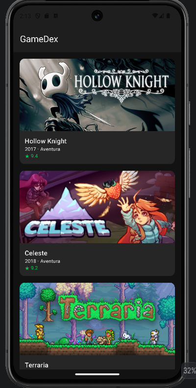
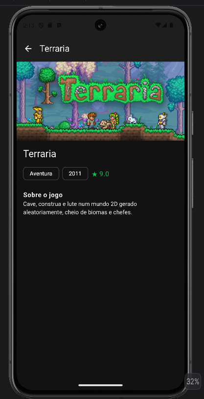

# GameDex 🎮

Catálogo de jogos para Android, feito com Kotlin e Jetpack Compose.
Navegue por uma lista de capas e toque em um jogo para ver gênero, ano, nota e descrição.

| Catálogo | Detalhe |
| --- | --- |
|  |  |

## Funcionalidades

- Lista rolável com 12 jogos, cada um num card com capa, título, ano, gênero e nota
- Tela de detalhe com imagem em destaque e descrição completa
- Navegação entre as telas com botão de voltar
- Capas carregadas da internet
- Tema escuro próprio, com destaque em verde

## Tecnologias

- **Kotlin** e **Jetpack Compose**
- **Material 3** (Scaffold, TopAppBar, Card, AssistChip)
- **Navigation Compose** com rotas tipadas (`@Serializable`)
- **Coil 3** para carregar imagens
- `LazyColumn` com `key` para uma lista eficiente

## Estrutura

```
app/src/main/java/br/ulbra/gamedex/
├── model/   → data class Jogo
├── data/    → JogoRepository (dados fixos no código)
└── ui/      → telas, card, rotas e tema
```

## Como rodar

1. Clone o repositório.
2. Abra no Android Studio e aguarde o Gradle sincronizar.
3. Rode em um emulador ou em um celular Android.

É preciso ter internet no aparelho para as capas aparecerem.

## Autor

**Matheus de Carvalho Schuh** 
